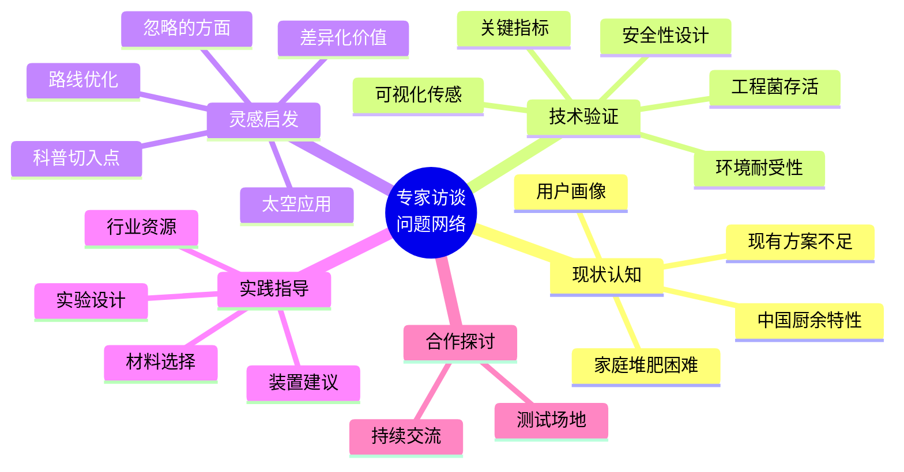
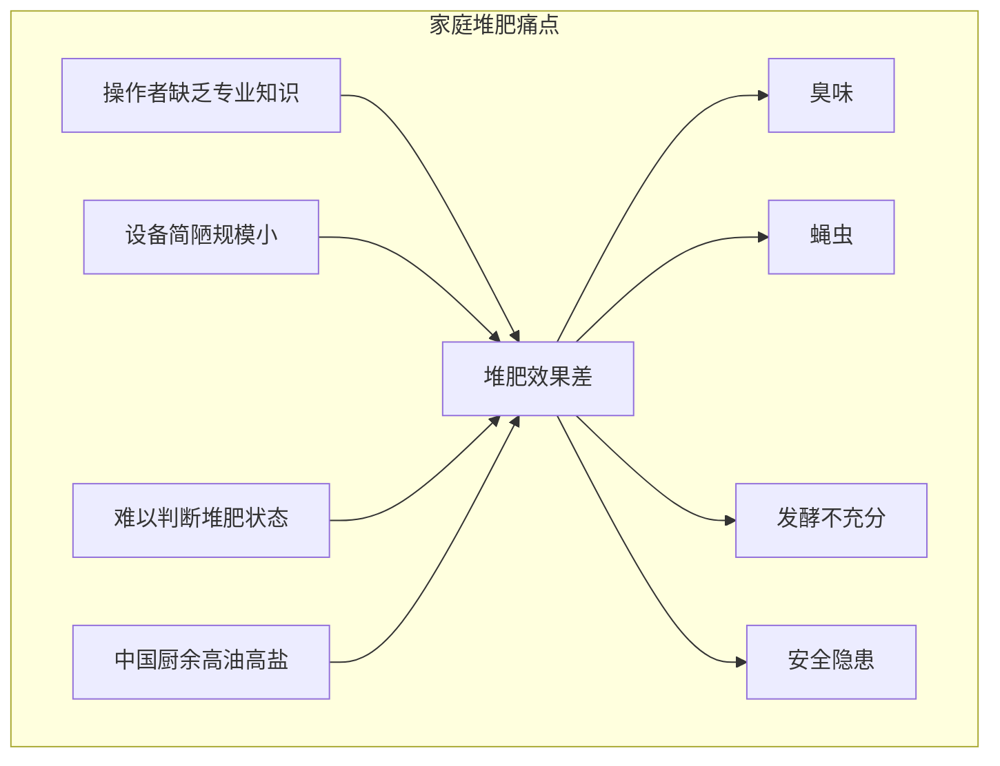
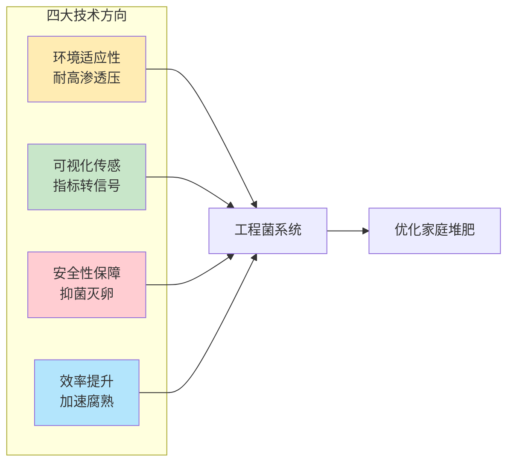
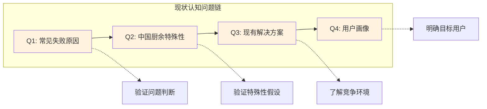
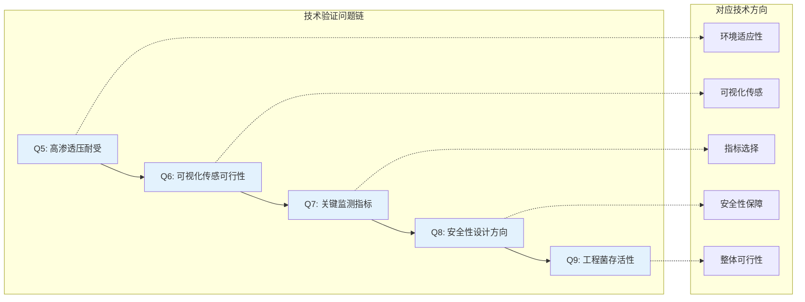
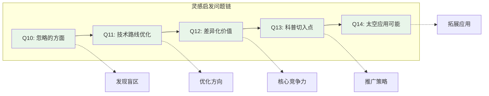
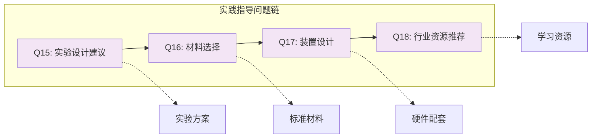
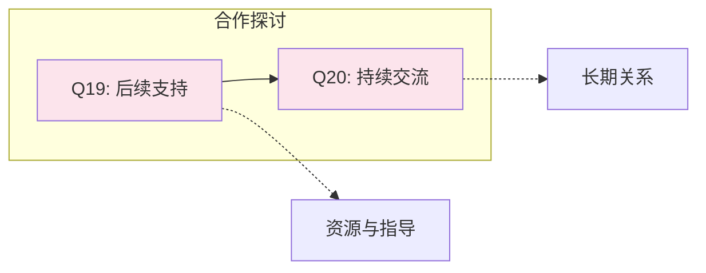
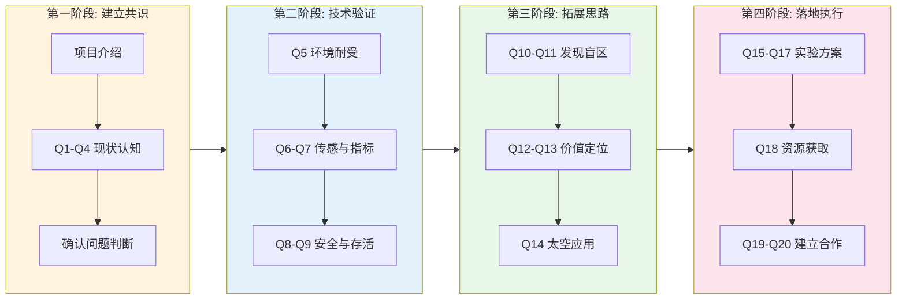
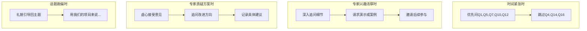

# 家庭堆肥优化项目专家访谈稿

## 访谈基本信息

| 项目       | 内容                    |
| -------- | --------------------- |
| **访谈目的** | 项目可行性验证、获取专业指导、寻求合作可能 |
| **访谈时间** | 2026年1月31日（周日）        |
| **访谈团队** | SZU-SIAT-China        |

---

## 问题网络总览

---

## 第一部分：开场与项目介绍

### 1.1 开场白

> 老师您好！非常感谢您抽出宝贵时间与我们交流。
>
> 我们是一支参加iGEM国际基因工程机器大赛的学生团队，目前正在开展一个与家庭堆肥相关的合成生物学项目。了解到您在堆肥领域有丰富的研究和实践经验，特别希望能向您请教一些问题，帮助我们更好地理解这个领域的实际情况，也想听听您对我们项目思路的看法。
>
> 在正式开始之前，请问您方便我们录音吗？主要是方便后续整理要点，不会用于其他用途。

---

### 1.2 项目介绍

#### 我们关注的问题

> 老师，我先简单介绍一下我们项目的背景和思路。
>
> **我们关注的问题是家庭堆肥的困境。** 虽然堆肥是很好的厨余处理方式，也契合中国传统农耕文化，但家庭堆肥实际操作中面临不少问题：
>
> - 操作者缺乏专业知识，主要靠经验摸索
> - 规模小、设备简陋，难以精准控制
> - 容易出现发酵不充分、臭味、蝇虫等问题
> - 很难判断堆肥进度，失败了也不知道
>
> 另外，中国家庭厨余有特殊性——烹饪习惯导致油、盐、糖含量偏高，种类也更多样。

#### 我们的解决思路

> **针对这些问题，我们想用合成生物学方法设计一套辅助系统，包括四个方面：**
>
> **第一，环境适应性。** 设计能耐受高油、高盐、高糖等高渗透压环境的工程菌，让它能在复杂厨余环境中存活工作。
>
> **第二，可视化传感。** 把温度、pH等关键指标转化成肉眼可见的信号——比如发出特定颜色的光，或者长出特定颜色的菌丝。普通人不需要了解堆肥的具体理论细节，看一眼就能知道堆肥状态，配合简单的"堆肥说明书"就知道下一步该怎么做。
>
> **第三，安全性保障。** 让工程菌能抑制有害杂菌、分解虫卵，即使堆肥没完全成功也能保持基本安全性。
>
> **第四，效率提升。** 加速腐熟，提高堆肥产品质量。
>
> 这是我们目前的大致思路，还比较初步，很多地方没想清楚，特别想听听您的意见。

---

## 第二部分：问题网络

### 2.1 现状认知类问题

**Q1. 关于家庭堆肥的普遍困难**

> 老师，根据您的了解和观察，目前家庭堆肥最常见的失败原因有哪些？我们总结的那些问题——臭味、蝇虫、发酵不充分——是不是比较普遍？还有没有我们没想到的常见问题？

**Q2. 关于中国厨余的特殊性**

> 我们推测中国家庭厨余的高油高盐特点可能会对堆肥造成影响，这个判断准确吗？在您接触的案例中，油盐含量高具体会带来什么问题？

**Q3. 关于现有解决方案**

> 目前市面上有没有一些针对家庭堆肥的产品或方法？它们的效果怎么样？主要的不足在哪里？

**Q4. 关于家庭堆肥的用户画像**

> 在您接触过的家庭堆肥实践者中，他们一般是什么样的人群？最在意的是什么——操作简便性、成本、还是堆肥效果？

---

### 2.2 技术可行性类问题

**Q5. 关于高渗透压耐受**

> 我们想让工程菌具备耐高渗透压的能力，您觉得在实际堆肥环境中这种能力有多重要？除了渗透压之外，还有哪些环境因素是我们必须考虑的？

**Q6. 关于可视化传感的实用性**

> 我们想通过生物发光或菌丝颜色变化来指示堆肥状态，您觉得这种方式在实际使用中可行吗？家庭用户能够接受和理解这种信号吗？

**Q7. 关于关键监测指标**

> 如果只能选择2-3个最关键的指标来监测家庭堆肥状态，您会建议监测哪些？温度、pH、含水量、还是其他的？

**Q8. 关于安全性设计**

> 我们想让工程菌能抑制有害杂菌、分解虫卵，从您的专业角度看，家庭堆肥中最需要警惕的安全风险是什么？我们的安全性设计方向对吗？

**Q9. 关于工程菌的实际应用**

> 在真实堆肥环境中——高温、复杂菌群竞争、营养波动——您觉得外来的工程菌能存活并发挥作用吗？有没有什么建议可以提高存活率？

---

### 2.3 灵感启发类问题

**Q10. 关于我们可能忽略的方面**

> 听完我们的项目思路，您觉得有没有什么重要的方面是我们没有考虑到的？或者有什么潜在问题需要注意？

**Q11. 关于技术路线的优化**

> 如果您来做这个项目，您会怎么设计？有没有什么更好的思路或者可以借鉴的方法？

**Q12. 关于差异化价值**

> 相比现有的堆肥添加剂或EM菌产品，您觉得我们这个项目如果要做出真正的价值和差异化，应该重点突破哪个方向？

**Q13. 关于教育科普的切入点**

> 我们希望项目也能起到科普教育作用，帮助更多人了解和实践堆肥。从您的经验来看，普及家庭堆肥最大的障碍是什么？怎样的科普方式可能更有效？

**Q14. 关于太空应用的可能性**

> 我们的项目可能会融入一些太空元素，比如太空站的有机废弃物处理。您觉得地球上的家庭堆肥技术和太空应用之间有没有什么共通点或可借鉴的地方？

---

### 2.4 实践指导类问题

**Q15. 关于实验验证**

> 如果我们要验证工程菌在堆肥中的实际效果，您建议怎么设计实验？需要关注哪些指标？有没有常见的坑需要避免？

**Q16. 关于堆肥材料的选择**

> 为了实验的可重复性，您建议我们用什么样的堆肥原料作为标准测试材料？有没有模拟中国家庭厨余的配方建议？

**Q17. 关于小规模堆肥装置**

> 针对家庭场景，您觉得什么样的堆肥装置设计比较合理？我们的工程菌系统可能需要配合怎样的硬件条件？

**Q18. 关于行业资源**

> 您能推荐一些堆肥领域的参考文献、标准、或值得关注的研究团队吗？或者有没有可能参观学习的堆肥设施？

---

### 2.5 合作探讨类问题

**Q19. 关于后续支持**

> 老师，我们的项目还处于比较早期的阶段，后续在推进过程中可能会遇到一些专业上的困难。想请教一下，如果我们在实验设计、数据分析或者堆肥相关的专业问题上遇到困惑，方便向您请教吗？另外，您这边有没有一些资源——比如文献资料、实验场地、或者可以对接的其他专家——是您觉得可能对我们有帮助的？我们非常珍惜这次交流的机会，也希望能和您保持联系。

**Q20. 关于持续交流**

> 如果后续方便的话，您更习惯什么样的沟通方式呢？比如邮件、微信、或者定期的线下交流？我们会及时向您汇报项目进展，也希望能继续得到您的指导。

---

## 第三部分：结束语

> 老师，今天的问题就是这些。非常感谢您花这么长时间给我们解答，让我们学到了很多。
>
> 您今天提到的建议对我们太重要了，我们回去会认真整理和讨论，后续有进展也会向您汇报。
>
> 按照iGEM比赛要求，我们会在项目报告中记录这次访谈作为Human Practices的一部分，会引用您的一些观点和建议，到时候会把相关内容发给您确认，请问可以吗？
>
> 再次感谢您！如果后续项目有成果，一定第一时间和您分享。

---

## 问题提问顺序与逻辑

---

## 访谈应变策略

---

## 访谈准备清单

### 访谈中

- [ ] 感谢并征得录音同意
- [ ] 项目介绍控制时间
- [ ] 认真倾听不急于打断
- [ ] 重要观点及时记录关键词
- [ ] 根据专家回答灵活调整问题顺序
- [ ] 留意新概念、人名、文献及时追问

### 访谈后

- [ ] 24小时内发送感谢信息
- [ ] 48小时内整理访谈记录
- [ ] 将建议整理成可执行行动项
- [ ] 重要引用内容发给专家确认
- [ ] 项目进展定期同步

---

## 关键信息记录表

| 类别 | 专家观点/建议 | 后续行动 |
|------|--------------|---------|
| 现状问题 | | |
| 技术可行性 | | |
| 改进建议 | | |
| 推荐资源 | | |
| 合作可能 | | |

---
